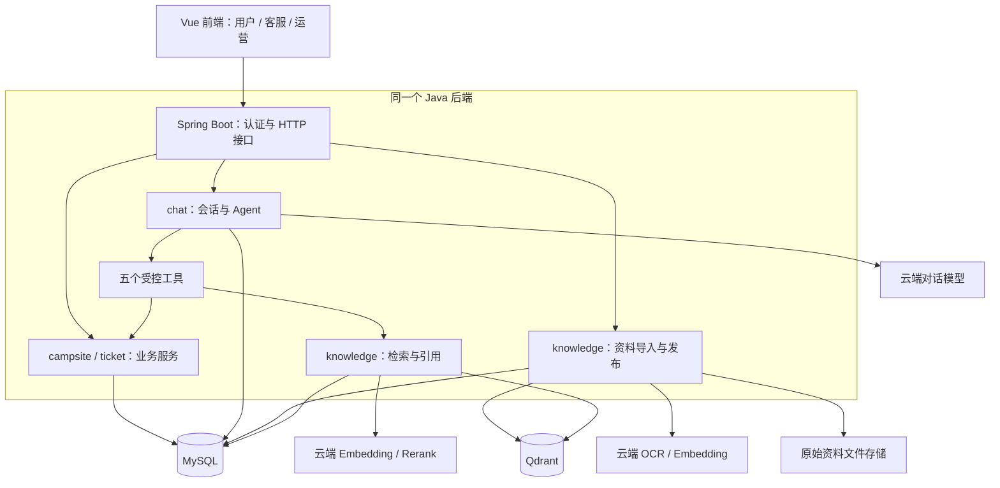

# 营地咨询与服务 Agent 项目实施计划

> - 更新日期 · 2026-11-09（Asia/Shanghai）。
> - 文档状态 · 2026-11-10本机优化已实施，六城最终回归仍为11/30，未达26/30。BM25开发口语集30/30，但新留出集23/30未达门槛。2026-11-11 已通过新公网 IP 发布并完成账号轮换。公网入口 `http://121.40.149.114:8090/`。下一步见第16节。
> - 适用对象：项目作者、后续开发者，以及需要快速了解项目的评审者。
> - 当前状态见[高德 MCP 验收记录](docs/AMAP-MCP-ACCEPTANCE.md)、[README](README.md)和[评测记录](docs/EVALUATION.md)。正式本机模式采用 DeepSeek + MySQL + BM25 关键词检索。第 12 至 14 节保留首版联调历史，第 15 节记录真实营地接入和覆盖门槛。

本文说明项目做什么、各模块放在哪里、模块之间如何配合，以及按什么顺序开发和验收。实施时以各阶段的实际代码和验证记录更新进度，不能把规划内容直接标记为已完成功能。

快速阅读：[全国营地 MCP 接入与优化计划](#15-全国营地-mcp-接入与优化计划) · [项目定位](#1-项目定位与已确认选择) · [总体架构](#2-总体架构与技术路线) · [目录与模块](#3-拟建项目目录与模块职责) · [Agent 流程](#4-agent-的实现方式) · [RAG 链路](#5-数据治理与-rag-链路) · [实施与验收](#9-分阶段实施与验收)。

## 1. 项目定位与已确认选择

### 1.1 项目要解决的问题

营地介绍、设施信息、收费说明和服务规则分散在不同资料中，用户需要反复搜索，客服需要重复回答相似问题。项目提供一个自然语言入口，让用户能够完成：

**咨询需求 → 查询营地 → 查阅规则 → 提交服务工单 → 查询处理进度。**

Agent 根据用户需求选择工具、追问缺失信息并组织回答；RAG 负责提供可追溯的知识证据；Java 业务服务负责权限、校验和数据写入。

### 1.2 已确认的项目选择

| 项目 | 第一版选择 |
| --- | --- |
| 项目名称 | 营地咨询与服务 Agent，工程名暂定 `camp-agent` |
| 建设方式 | 独立仓库、独立数据库、独立部署 |
| 主要用途 | Java Agent 应用实践、求职项目展示与可复现演示 |
| 开发语言 | Java |
| 核心业务 | 咨询、查询、服务工单 |
| 数据来源 | 共同准备并人工核对的演示资料 |
| 模型资源 | 国内云 API |
| 资料处理 | 文本、PDF、Word 和图片 OCR |
| 时间投入 | 一人每天约 2—3 小时，按 4—6 周安排 |
| 交付目标 | 本地验收通过后部署公网演示 |

周数从正式开工日计算，不使用简历中的历史时间作为实际开发日期。第 4 周形成完整本地闭环，第 5—6 周完成评测、修正和上线验证。

### 1.3 与“毕设1”的关系

现有“毕设1”提供业务参考，新应用运行时不依赖旧项目的数据库、登录态或接口。

| 可参考内容 | 参考价值 | 当前参考位置 |
| --- | --- | --- |
| 营地属性 | 地区、设施、收费说明、禁火等领域字段 | [Campsite.java](D:/毕设1/后端代码/camping-planner-backend/src/main/java/com/camping/entity/Campsite.java) |
| 营地查询条件 | 地区、设施、类型等结构化筛选方式 | [CampsiteQueryReq.java](D:/毕设1/后端代码/camping-planner-backend/src/main/java/com/camping/campsite/dto/CampsiteQueryReq.java) |
| AI 业务处理经验 | 参数校验、模型异常处理、结果校验和确认后应用 | [AiService.java](D:/毕设1/后端代码/camping-planner-backend/src/main/java/com/camping/ai/AiService.java) |

上述路径属于当前参考工程，不属于新项目目录。旧项目已有的 AI 清单和时间表生成不能算作新项目的 RAG、客服会话或工单能力。

### 1.4 用户角色与首版边界

| 角色 | 核心操作 | 主要界面 |
| --- | --- | --- |
| 用户 `USER` | 查营地、问规则、比较营地、确认工单、查看自己的进度 | 聊天页、我的工单 |
| 客服 `STAFF` | 查询公开及内部客服资料、处理工单、填写处理结果 | 聊天页、客服工作台 |
| 运营 `OPS` | 维护营地信息、审核发布知识资料、查看汇总指标 | 运营工作台 |

预订咨询覆盖收费说明、预订流程、改期和取消规则。第一版没有营位库存和交易订单，不能回答“已锁定营位”“预订成功”或未经查询的实时余位。

首版不建设真实支付、自动退款、多智能体协作、模型训练、语音交互和通用图像理解。图片处理的能力边界是文字提取；用户不直接通过聊天上传任意图片，知识资料由运营导入。

## 2. 总体架构与技术路线

### 2.1 系统组成

采用一个 Vue 前端和一个 Spring Boot 后端。后端内部按业务模块组织，作为一个应用部署，不拆分微服务。



- **MySQL** 是用户、营地、文档发布状态和工单等业务数据的事实来源。
- **Qdrant** 保存知识片段及检索索引，不承担业务事务。
- **文件存储** 保留原始资料，便于审核、引用追溯和重新索引。
- **云端模型** 提供语言理解、向量化、重排序和 OCR，业务权限与写入仍由后端控制。
- **工具调用** 在后端内部调用 Java 业务服务，与页面接口共用校验逻辑，不通过 HTTP 绕回自身。

### 2.2 技术基线

| 部分 | 规划选型 | 用途 |
| --- | --- | --- |
| Java 后端 | Java 21、Spring Boot 4.1.1 | HTTP 服务、业务逻辑和应用配置 |
| Agent 框架 | Spring AI 2.0.1 | 模型接入、工具调用、会话上下文 |
| 认证授权 | Spring Security，BCrypt 密码哈希，JWT 登录凭证 | 登录、角色限制和资源归属检查 |
| 前端 | Vue 3、Vite、Element Plus | 聊天、工单和运营界面 |
| 业务数据库 | MySQL 8.x，Spring JDBC 参数化访问 | 持久化业务数据，避免增加 ORM 适配工作 |
| 检索数据库 | Qdrant | 向量检索、BM25 全文检索及结果融合 |
| 文档解析 | PDFBox、Apache POI | PDF 按页提取、DOCX 段落和表格提取 |
| 模型平台 | 阿里云百炼 | 统一管理云模型接入配置 |
| 对话与工具调用 | `qwen-plus` | 意图理解、追问、工具选择、回答生成 |
| 向量化 | `text-embedding-v4`，初始使用 1024 维 | 将问题和知识片段转换为语义向量 |
| 重排序 | `qwen3-rerank` | 对召回候选片段重新排序 |
| 图片文字提取 | `qwen-vl-ocr` | 从公告图片、扫描页中提取文字 |
| 部署 | Docker Compose、Nginx、HTTPS | 单机部署及统一访问入口 |

版本和模型名称沿用已讨论的规划基线，不代表已经完成依赖构建或真实 API 验证。第 1 周验证兼容性、模型可用性和工具调用行为，并将实际版本固定在 `pom.xml`、前端锁文件及部署配置中；如有调整，在本文记录原因。

第一版不引入 Redis、消息队列、独立搜索集群或通用 Agent 平台。文档导入使用后端的有界后台任务，并将处理状态持久化；重启中断的任务能够标记失败并重试。

## 3. 拟建项目目录与模块职责

### 3.1 独立项目目录

下图是启动项目时拟定的目录基线。现有工程位于 `D:\camp-agent`，以 [README](README.md) 的启动命令和仓库文件为准。全国营地 MCP 拟改位置见第 15.3 节。

```text
camp-agent/
├── PLAN.md                          # 本实施计划及进度记录
├── README.md                        # 项目介绍与本地启动入口
├── .gitignore
├── backend/
│   ├── pom.xml
│   └── src/
│       ├── main/
│       │   ├── java/com/campagent/
│       │   │   ├── CampAgentApplication.java
│       │   │   ├── config/           # 模型客户端、安全与文件存储配置
│       │   │   ├── auth/             # 登录、用户身份、三类角色
│       │   │   ├── chat/             # 对话接口、会话记录、Agent 编排
│       │   │   │   └── tool/         # 五个工具的定义及业务调用入口
│       │   │   ├── knowledge/        # 资料解析、分块、发布、检索、引用
│       │   │   ├── campsite/         # 营地查询和运营维护
│       │   │   ├── ticket/           # 工单草稿、确认、处理、进度查询
│       │   │   └── common/           # 统一响应、异常和必要公共校验
│       │   └── resources/
│       │       ├── application.yml
│       │       └── prompts/         # Agent 和基于证据回答的提示词
│       └── test/java/com/campagent/  # 单元、集成、评测相关测试
├── frontend/
│   ├── package.json
│   ├── package-lock.json
│   └── src/
│       ├── api/                     # 登录、聊天、营地、工单、知识库接口
│       ├── router/                  # 页面路由与登录状态检查
│       ├── stores/                  # 当前用户和会话界面状态
│       ├── components/              # 引用卡片、工单确认卡片等复用组件
│       └── views/
│           ├── login/               # 演示账号登录
│           ├── chat/                # 对话、引用、工具摘要和确认卡片
│           ├── tickets/             # 用户自己的工单列表与详情
│           ├── staff/               # 客服工单工作台
│           └── ops/                 # 营地维护、资料发布、指标汇总
├── database/
│   ├── 01_schema.sql                # 新项目首次建库脚本
│   ├── 02_demo_data.sql             # 虚构营地和演示数据
│   └── migrations/                  # 后续增量修改，按顺序执行
├── data/
│   ├── knowledge/                   # 明确标注为演示资料的受控语料
│   │   ├── manifest.jsonl           # 资料 ID、营地、类别、版本和权限
│   │   └── sources/                # 文本、PDF、DOCX 和公告图片
│   └── evaluation/
│       ├── dev.jsonl                # 50 个调试案例
│       └── acceptance.jsonl         # 150 个独立验收案例
├── deploy/
│   ├── compose.yml
│   ├── .env.example                 # 变量名和说明，不放真实密钥
│   └── nginx.conf
└── docs/
    ├── API.md                       # 接口参数、响应与错误约定
    ├── EVALUATION.md                # 评测方法、结果与已知限制
    ├── DEPLOYMENT.md                # 部署、升级、备份与恢复
    └── DEMO.md                      # 固定演示脚本与角色操作步骤
```

原始上传文件、数据库数据卷、Qdrant 数据卷、日志和构建产物放在运行目录或持久化卷中，不提交 Git。`data/knowledge` 只保存可公开的演示资料。

### 3.2 后端模块之间如何配合

| 模块 | 负责内容 | 依赖关系与边界 |
| --- | --- | --- |
| `auth` | 登录、解析身份、检查角色 | 其他模块从可信服务端上下文获得身份 |
| `chat` | 对话历史、上下文、Agent 工具循环、响应组装 | 通过工具访问知识与业务，不自行拼接 SQL 修改业务 |
| `chat/tool` | 定义模型可调用的方法和参数 | 委托 `knowledge`、`campsite`、`ticket` 的服务执行 |
| `knowledge` | 导入、审核、索引、检索、引用校验 | 使用文件存储、MySQL、Qdrant 和模型 API |
| `campsite` | 营地结构化查询、详情、运营编辑 | MySQL 保存当前数据；页面和工具共用服务逻辑 |
| `ticket` | 草稿、确认、幂等提交、处理和查询 | 负责权限及状态流转，模型不能绕过确认 |
| `config` / `common` | 配置、统一异常、响应等基础能力 | 只提取已被多个模块使用的公共内容 |

每个业务模块内部按需要设置 Controller、Service、Repository 和 DTO。模块较小时保持少量类，不预先创建空接口、通用工厂或多层包装。

### 3.3 前端工作区

| 工作区 | 页面需要展示的内容 |
| --- | --- |
| 聊天页 | 会话列表、消息、处理中/完成/失败状态、营地结果卡片、引用原文、待确认工单 |
| 我的工单 | 本人提交的工单、当前状态、客服公开回复和处理时间 |
| 客服工作台 | 待处理列表、工单详情、处理操作、资料查询入口 |
| 运营工作台 | 营地维护、资料上传与解析预览、版本发布/下架、调用和质量指标 |

聊天页可展示“查询了哪个营地、引用了哪些资料”等工具执行摘要，不展示模型内部思维过程。键盘操作、表单标签、提交状态和错误提示应完整可用。前端路由限制仅辅助交互，真实权限由后端检查。

## 4. Agent 的实现方式

### 4.1 五个工具

第一版使用一个主 Agent，通过 Spring AI 工具调用机制暴露以下方法：

| 工具 | 主要输入 | 返回内容 | 业务写入 |
| --- | --- | --- | --- |
| `searchCampsites` | 地区、设施、类型、关键词等筛选条件 | 满足条件的营地及关键属性 | 无 |
| `getCampsite` | 已确认的营地 ID | 营地当前信息与更新时间 | 无 |
| `searchKnowledge` | 问题、已解析的营地上下文 | 证据片段、来源位置、版本和引用 ID | 无 |
| `prepareTicket` | 工单类别、营地、标题、问题描述 | 待确认草稿及展示内容 | 仅保存草稿，不创建正式工单 |
| `queryMyTickets` | 可选工单编号、状态 | 当前用户自己的工单与公开处理进度 | 无 |

工具参数中不接受由模型提供的用户 ID、角色或任意 SQL。检索权限、工单归属、营地可见性均从登录身份和业务数据库校验。

### 4.2 一次请求的处理过程

1. 接口验证登录态、消息长度和会话归属，生成请求标识。
2. 从 MySQL 加载当前会话的上下文，提示词使用最近 10 轮和当前选定的营地/草稿状态。
3. Agent 判断是否需要追问，或调用已注册的工具。
4. 工具验证参数，读取业务数据或检索知识证据，将结果返回 Agent。
5. Agent 组织回答，服务端核验引用 ID 和待确认草稿是否来自本次有效结果。
6. 保存消息及执行记录，返回回答、引用、工具摘要和草稿卡片。

每次请求最多进行 4 轮工具调用。达到上限时结束请求并提示缩小问题，不能无限循环。模型服务、工具和请求均设置超时，具体数值在第 1 周接入测试后固定。

历史消息可以帮助理解“第二个营地”等指代，但收费信息、工单状态等当前事实仍需重新查询。切换营地或条件时，不沿用不再适用的旧证据。

### 4.3 两条核心业务链路

**查询与规则咨询示例：**

用户：“找一个杭州附近、有洗手间、能带宠物的营地。”

先通过 `searchCampsites` 筛选结构化设施，再通过 `searchKnowledge` 检索候选营地的宠物规定。缺少规定时说明无法确认，不根据营地名称或模型常识推断。用户接着问“第二个怎么预订”，继续定位该营地并检索预订说明。

**服务工单链路：**


首版以页面确认按钮提交正式工单。聊天中说“帮我提交”可以触发草稿准备，但不能代替确认接口的校验。确认提交前的任何失败都不得产生正式工单。

同一草稿只能对应一张正式工单，通过数据库唯一约束和事务保证；重复确认返回同一结果。修改未确认草稿时生成新的草稿 ID，并在同一事务中使旧草稿失效；旧确认卡片再次提交时返回“草稿已失效”，不能提交旧内容。已确认草稿不再修改，正式工单内容不能被后续对话悄悄覆盖。

工单类别为咨询、投诉和建议。状态主线为 `待处理 → 处理中 → 已解决 / 已关闭`；关闭时需要处理说明，客服操作保存处理记录。用户只读自己的工单进度，客服通过专用业务接口处理，不向模型开放任意改状态工具。

## 5. 数据治理与 RAG 链路

### 5.1 演示资料规模与类别

初始目标是 5 个虚构营地、约 60 份资料、12 类业务内容：

| 序号 | 类别 | 示例内容 |
| --- | --- | --- |
| 1 | 营地概况 | 位置、类型、适用人群、开放情况 |
| 2 | 交通停车 | 到达方式、停车地点、步行路线说明 |
| 3 | 设施使用 | 水电、洗手间、公共区域的使用说明 |
| 4 | 收费说明 | 演示收费项目、包含内容与例外 |
| 5 | 预订流程 | 预订所需信息、咨询方式、确认流程 |
| 6 | 改期取消 | 营地自行设定的演示服务规则 |
| 7 | 入住离场 | 办理时间、所需信息、离场检查 |
| 8 | 宠物规定 | 是否允许、活动区域、管理要求 |
| 9 | 亲子须知 | 设施使用限制与陪同要求 |
| 10 | 消防规定 | 营地禁火、指定区域等已明确规则 |
| 11 | 天气与闭园通知 | 运营发布的临时公告及生效范围 |
| 12 | 投诉服务 | 联系方式、处理步骤、进度查询方式 |

“12 类”是业务资料类别，不是文件格式数量。资料允许借鉴旧项目的领域字段，但使用虚构名称和明确标注的演示规则，不把生成内容描述为真实营地政策。

支持的格式为 Markdown/TXT、PDF、DOCX、PNG/JPG。PDF 保留页码，Word 保留段落或表格位置，图片保留图片来源；扫描 PDF 通过按页转图后调用 OCR 处理。

### 5.2 导入、审核和发布

```text
运营上传资料
  → 检查格式、大小、页数和访问范围
  → 保存原文件
  → 文本提取 / OCR
  → 清洗、预览与人工核对
  → 按章节、段落和表格分块
  → 生成向量，写入向量与全文索引
  → 发布版本
  → 新的问答请求可以检索
```

文档必须关联营地、业务类别、资料 ID、版本、来源位置和访问范围。运营核对解析内容后发起发布；索引成功才切换为已发布版本，解析或索引失败时保持未发布并展示失败原因。

每块目标约 400—800 个中文字符，优先保持段落、规则和表格语义完整。切分长表格时保留列标题；针对过长段落允许有少量上下文重叠。分块参数由调试集验证后固定。

同一逻辑文档的相同内容重复导入不重复建索引。内容变化产生新版本，保留旧版本原文件用于追溯。文档中的指令、脚本和链接仅作为资料内容，不触发工具执行或自动访问。

### 5.3 检索与重排序

RAG 指先检索相关资料，再由模型基于资料回答。Embedding 将文本转换成向量，用于寻找语义接近的内容；BM25 补充关键词匹配；Rerank 对候选证据再排序。

按以下顺序实现，保留相同评测条件下的对照结果：

| 阶段 | 检索方式 | 需要回答的问题 |
| --- | --- | --- |
| 基线 | 仅向量检索 | 能否找到语义相关的正确资料？ |
| 混合检索 | 向量 Top 20 + BM25 Top 20，RRF 融合并按片段 ID 去重 | 营地名、设施简称和精确规则匹配是否改善？ |
| 完整链路 | 对融合结果进行重排序，取前 5 条作为回答证据 | 正确证据是否排得更靠前，回答是否更准确？ |

Qdrant 使用支持 BM25 评分的全文索引和多语言分词，并通过原生查询能力完成融合；不假定框架的普通向量检索接口已经包含混合检索。云端重排序通过独立 API 接入。

检索必须带营地和访问范围约束。返回模型前，服务端再次检查片段对应文档仍处于有效发布状态，禁止引用已下架、旧版本或无权访问的资料。

### 5.4 回答依据与数据更新

每条引用展示资料标题、版本、页码或段落位置，以及原文摘录。引用 ID 必须属于此次实际检索结果；校验引用存在不能替代对回答正确性的人工评测。

历史会话保留当时的回答和引用标识。查看历史引用原文时仍按当前权限校验；有权访问时允许查看对应旧版本，并标注“已更新”或“已下架”，无权访问时不返回原文。旧版本仅供历史追溯，不参与新回答。

| 数据 | 读取与更新方式 |
| --- | --- |
| 营地设施、当前收费说明等结构化字段 | 以 MySQL 为准，工具每次读取；运营修改后下次查询生效 |
| 预订、宠物、取消等文档规则 | 以当前已发布文档版本为准；新索引完成后切换版本 |
| 工单状态和回复 | 每次查询业务数据库，不写入公共知识库 |
| 下架或替换的资料 | 新回答禁止引用；检索索引清理可重试，但业务有效性检查不能省略 |

知识文档和结构化字段应避免重复维护同一个事实。发现两者冲突时说明冲突并交给运营核实，不能默默选择对用户更有利的说法。无证据、证据不足或存在无法消解的冲突时追问，或引导提交咨询工单。

本版验证的是业务信息即时读取和文档发布后更新索引，没有真实第三方系统接入时，不把它表述为已经完成外部系统实时同步。

## 6. 数据模型与存储职责

以下为建表阶段的数据职责基线，不是已经执行的 SQL。字段类型和索引在实现对应模块时补齐；不为首版范围之外的功能提前建表。

| 数据对象 / 拟定表名 | 保存什么 | 关键关系与约束 |
| --- | --- | --- |
| `app_user` | 登录名、密码哈希、角色、状态 | 身份由后端解析，不接受模型指定角色 |
| `campsite` | 虚构营地的结构化属性及更新时间 | 被知识资料和工单引用 |
| `conversation` | 会话名称、所属用户、上下文状态 | 一个用户可有多个会话 |
| `chat_message` | 用户及助手消息、引用快照和时间 | 归属一个会话，历史消息不作为当前业务事实 |
| `knowledge_document` | 逻辑文档、营地、类别、访问范围、当前发布版本 | 指向一个当前有效版本 |
| `knowledge_version` | 原文件位置、内容哈希、处理状态、发布记录 | 属于一个逻辑文档，失败版本不可发布 |
| `knowledge_chunk` | 片段原文、版本、位置和索引标识 | Qdrant 记录通过片段 ID 与其对应，可据此重建索引 |
| `ticket_draft` | 用户确认前的工单内容、归属、确认及失效状态 | 修改生成新 ID 并使旧草稿失效，已确认草稿不可修改 |
| `service_ticket` | 工单编号、类别、描述、所属用户、营地和状态 | 草稿 ID 唯一，保证确认幂等 |
| `ticket_event` | 客服处理、状态变化、公开回复和时间 | 归属一个正式工单 |
| `agent_run` | 请求标识、模型、阶段耗时、调用用量和执行结果 | 用于排查、性能和成本统计，不记录密钥 |

关系主线：

```text
用户 → 会话 → 消息
营地 → 逻辑文档 → 文档版本 → 知识片段 → Qdrant 索引
用户 → 工单草稿 → 正式工单 → 处理记录
聊天请求 → 执行记录 → 检索 / 模型 / 工具调用统计
```

发布新知识版本时，索引先准备好，再通过 MySQL 事务切换当前版本；检索侧校验当前版本，避免双写失败暴露半成品。工单确认在同一数据库事务中处理草稿状态和正式工单创建。

## 7. HTTP 接口与前后端协作

接口由新后端实现，具体字段和错误码随对应阶段写入 `docs/API.md`。下表用于固定模块边界及主要调用关系。

| 方法与路径 | 使用者 | 作用 |
| --- | --- | --- |
| `POST /api/auth/login` | 演示账号 | 登录并获取身份凭证 |
| `GET /api/auth/me` | 已登录用户 | 获取当前用户和角色 |
| `POST /api/chat` | 用户、客服 | 提交问题和会话 ID，执行一次 Agent 请求 |
| `GET /api/conversations` | 用户、客服 | 查询自己的会话列表 |
| `GET /api/conversations/{id}/messages` | 会话所有者 | 查看会话消息及引用 |
| `GET /api/campsites` | 已登录用户 | 结构化营地查询 |
| `GET /api/campsites/{id}` | 已登录用户 | 营地详情 |
| `POST /api/ticket-drafts/{id}/confirm` | 草稿所有者 | 确认草稿，幂等创建正式工单 |
| `GET /api/tickets`、`GET /api/tickets/{id}` | 用户 | 本人的工单列表与详情 |
| `GET /api/staff/tickets`、`GET /api/staff/tickets/{id}` | 客服 | 工作队列与待处理工单详情 |
| `PATCH /api/staff/tickets/{id}` | 客服 | 更新处理状态并填写回复 |
| `GET /api/ops/campsites`、`POST /api/ops/campsites`、`PUT /api/ops/campsites/{id}` | 运营 | 查询、创建和编辑营地信息 |
| `GET /api/ops/documents`、`POST /api/ops/documents` | 运营 | 文档列表和上传新文档或新版本 |
| `GET /api/ops/documents/{id}` | 运营 | 解析状态、版本、原文件和提取内容预览 |
| `POST /api/ops/documents/{id}/publish` | 运营 | 确认待发布版本，索引完成后切换 |
| `POST /api/ops/documents/{id}/unpublish` | 运营 | 下架逻辑文档，使新问答不再引用 |
| `GET /api/knowledge/citations/{id}` | 有资料访问权限的用户 | 查看服务端生成的引用及原文上下文 |
| `GET /api/ops/metrics` | 运营 | 查看调用、失败、耗时和用量等汇总 |

`POST /api/chat` 接收 `message` 和可选 `conversationId`。新会话由后端创建并绑定当前用户；响应至少包含 `requestId`、`conversationId`、`answer`、`citations`、`toolSummary` 和可选 `pendingTicketDraft`。

第一版使用普通 HTTP 请求返回完整结果。前端展示明确的处理中、成功和失败状态，不把“请求已接收”或加载动画计为回答完成。客服回复和工单确认直接使用业务接口，不依赖模型生成接口参数后盲目执行。

## 8. 权限、校验与失败处理

| 场景 | 必须实现的行为 |
| --- | --- |
| 跨用户查询会话、草稿或工单 | 服务端拒绝访问，即使请求中提供了有效 ID |
| 普通用户要求读取内部资料 | 检索前限制范围，返回模型前再次核验权限 |
| 模型生成非法参数或未知工具 | 拒绝执行，不通过字符串拼接运行代码或 SQL |
| 资料中包含提示词注入 | 作为不可信资料处理，不改变身份、工具权限或确认要求 |
| 模型、向量化、检索或重排序超时/限流 | 返回可识别的失败状态，不伪造答案或业务成功 |
| 无答案、证据不足、资料冲突 | 说明限制、追问或提供咨询工单入口 |
| OCR 无有效文字、文件损坏、格式不支持 | 标记处理失败，保留原因，不进入可检索范围 |
| 索引写入中断 | 当前已发布版本继续有效，新版本保持未发布并可重试 |
| 工单重复确认或提交旧卡片 | 已确认草稿返回同一工单，已被替换的旧草稿拒绝提交 |
| 客服并发处理同一工单 | 检查当前状态和版本，防止覆盖已发生的处理结果 |

模型 Key、JWT 密钥和数据库密码通过服务端环境变量提供，不传入浏览器，不提交仓库。文件下载经过权限检查，上传文件与解析过程设置资源上限；用户输入和模型回答在前端展示时进行安全渲染。

日志记录请求标识、耗时、错误分类和用量，不记录 Key、完整敏感提示词或完整个人投诉内容。公开演示启用每用户调用限流及应用用量限制，避免无限工具循环和失控调用。

## 9. 分阶段实施与验收

### 9.1 六周安排

| 阶段 | 主要任务 | 阶段交付物 | 完成标准 |
| --- | --- | --- | --- |
| 第 1 周：最小 Agent | 独立工程、模型接入验证、演示账号、营地查询工具 | 可启动后端、5 个虚构营地、最小工具调用用例 | 自然语言能够触发真实业务查询；追问、无结果、非法参数和超时有明确行为 |
| 第 2 周：知识库基线 | 资料准备、解析/OCR、预览、分块、向量检索和引用 | 可导入的语料、索引、向量检索基线 | 固定问题能够定位原文；解析失败资料不可用，OCR 内容可人工核对 |
| 第 3 周：检索与多轮 | BM25、融合、重排序、会话指代、版本过滤 | 三种检索方案的开发集对照结果 | “第二个营地”等追问和切换营地正确；不引用无权限或下架资料 |
| 第 4 周：业务闭环 | 工单草稿与确认、客服处理、用户查询，完成三个工作区 | 本地可完整演示的应用 | 用户提交→客服处理→用户查结果全流程通过；确认幂等和权限隔离通过 |
| 第 5 周：评测与修正 | 固定验收集、失败用例、性能与成本统计 | 评测报告、问题修正记录 | 明确检索、生成和工具执行各自的问题，达到质量门槛并记录波动 |
| 第 6 周：公网演示 | 部署、HTTPS、演示账号、备份恢复、演示文档 | 公网应用、部署与演示材料 | 公网全流程、重启持久化、备份恢复验证通过 |

每阶段按“解释一个业务流程 → 实现最小闭环 → 固定用例验收 → 更新记录”的顺序推进。前端先满足当前阶段联调，第 4 周完成全部工作区。

### 9.2 当前任务进度

- [x] 确认独立 Java Agent、业务范围、资料来源、周期与公网演示目标。
- [x] 将方案整理为本实施计划。
- [x] 第 1 周：创建独立工程并验证最小工具调用（DeepSeek 实际 API）。
- [ ] 第 2 周：完成资料导入和向量检索基线。
- [ ] 第 3 周：完成混合检索、重排序和多轮会话（多轮与 BM25 已联调，真实向量/重排序及对照评测未完成）。
- [x] 第 4 周：完成工单闭环和三个工作区（本机演示与接口验证；公网另验）。
- [ ] 第 5 周：完成独立评测与问题修正（94 条检索和 34 条真实对话基线已完成，缺陷修复与新增样本见第 15 节）。
- [ ] 第 6 周：完成公网部署和验收。

### 9.3 测试集与质量门槛

准备 200 个固定案例，包含单轮问题和多轮业务任务。50 个用于调试，150 个用于独立验收；在调参前划分并固定，验收结果不用于反复挑选有利参数。

每个案例记录类别、输入/前置会话、预期工具或业务结果、应引用的资料版本与原文，以及判定标准。检索指标只对有标准证据的知识问答子集计算。

| 检查项 | 验收口径 |
| --- | --- |
| 证据命中率 Hit@5 | 有标准证据的知识问题中，前 5 条至少命中一条标注证据的比例，目标 ≥90%；多证据问题另外检查证据是否齐全 |
| 回答正确且有据 | 人工核对事实正确、关键结论受到引用支持的回答比例，目标 ≥90% |
| 工具任务完成率 | 以业务目标完成且没有错误操作为成功；固定工具任务每例运行 3 次，总体成功比例目标 ≥90%，并单列各类结果；越权或未经确认写入属于不通过 |
| 确定性业务规则 | 工单确认、重复提交、资源归属、角色隔离和状态流转等用例全部通过 |
| 异常与拒答 | 覆盖无答案、冲突/过期资料、OCR 错误、注入、超时和限流，并核对没有错误写入或虚假成功 |
| 性能 | 记录从提交到完整回答的 P50/P95，并分解检索、重排序、模型和工具耗时 |
| 调用成本 | 记录请求次数、输入/输出用量及能取得的计费数据；估算费用时注明单价与统计日期 |
| 可复现性 | 保存语料版本、模型名称、参数、测试日期、原始结果与评判说明 |

自动测试重点覆盖参数、权限、版本切换、索引失败、确认幂等和状态变化。真实模型评测单独运行并记录，不让普通单元测试默认消耗云 API 费用。人工验收覆盖资料预览、来源查看、确认卡片及三个角色的完整操作。

“3 秒以内”是待实测的优化目标，不是当前已达成成果。首版统计完整回答耗时；未来增加流式输出时，首字时间应单独统计，不能与完整回答时间混用。

## 10. 部署、交付与后续维护

### 10.1 本地与公网部署

本地开发先启动 MySQL、Qdrant，再启动 Java 后端和 Vue 开发服务。公网由 Nginx 提供前端静态文件与 HTTPS，并将 `/api` 转发到后端；MySQL 和 Qdrant 仅在应用内部网络开放。

服务器、域名和可用模型账号是上线前置资源，在第 1 周确认准备情况。不默认复用旧项目服务器，也不假定旧服务器容量足够。具体机器规格以第 5 周实测的资源占用和演示并发确定。

业务库、上传文件及检索数据使用持久化卷。备份覆盖业务库和原始资料；检索索引应能够重建，恢复时记录所需时间。已有数据库升级只执行增量脚本，不重跑首次建库脚本。

部署完成后重新验证登录、营地查询、引用问答、确认工单、客服处理和用户查进度，并验证重启与备份恢复。服务可访问不等于功能已验收。

### 10.2 交付清单

- 独立的新项目源码及前后端依赖锁定记录。
- 数据库初始化、演示数据和增量迁移脚本。
- 5 个虚构营地、约 60 份资料与资料清单。
- 200 个评测案例、对照实验、验收结果及已知限制。
- 接口说明、部署说明、备份恢复步骤和环境变量模板。
- 公网演示地址、用户/客服/运营演示账号及固定演示脚本。
- 与实际功能和实测结果一致的项目说明及简历表述。

### 10.3 简历成果的证据要求

| 期望表述 | 项目需要提供的证据 |
| --- | --- |
| 10+ 类资料治理 | 12 类业务资料清单、解析/OCR 样例、人工审核记录 |
| 混合检索与重排序优化 | 相同测试条件下的向量、混合、重排序对照结果 |
| 降低无依据回答 | 引用正确性、证据支持和无答案场景的评测记录 |
| 多轮会话与业务处理 | 查询、追问、确认提交、客服处理、进度查询的操作与测试记录 |
| 信息及时更新 | 修改营地字段、替换/下架文档后新查询生效的测试 |
| 响应速度改善 | 明确测试条件、样本量、完整回答耗时及 P50/P95 |
| 已上线 | 实际部署日期、访问地址和公网验收记录 |

“人工工作量减少 60%”“满意度达到 94%”“人工平均 8 分钟”等业务数字需要真实运营统计。离线评测、虚构资料和演示账号不能证明这些指标。项目时间、职责和成果均按实际记录填写。

### 10.4 下一步与更新方式

当前先修复无可核实资料时的引用判定，再按第 15 节接入并验收真实营地查询。`searchCampsites` 目前查询独立应用库的演示营地。

后续每完成一个阶段，更新第 9.2 节进度，并在下表添加证据；范围、版本或流程变化时同时修改相应章节，避免计划与代码长期不一致。

| 日期 | 阶段 | 变更或验证结果 | 证据位置 |
| --- | --- | --- | --- |
| 2026-11-04 | 规划 | 将已讨论方案整理为独立项目的结构、流程与实施基线；尚未实现应用 | 本文 |

## 11. 技术参考

以下链接用于实施时查阅 API 和兼容性；文档可访问不代表本项目已经完成集成。

- [Spring Boot 环境要求](https://docs.spring.io/spring-boot/system-requirements.html)
- [Spring AI 入门与版本兼容](https://docs.spring.io/spring-ai/reference/getting-started.html)
- [Spring AI 工具调用](https://docs.spring.io/spring-ai/reference/api/tools.html)
- [Spring AI 会话记忆](https://docs.spring.io/spring-ai/reference/api/chat-memory.html)
- [Qdrant 混合查询](https://qdrant.tech/documentation/search/hybrid-queries/)
- [Qdrant 索引与分词](https://qdrant.tech/documentation/manage-data/indexing/)
- [百炼工具调用](https://help.aliyun.com/zh/model-studio/qwen-function-calling)
- [百炼文本向量化](https://help.aliyun.com/zh/model-studio/text-embedding-synchronous-api)
- [百炼重排序](https://help.aliyun.com/zh/model-studio/text-rerank-api)
- [百炼 OCR](https://help.aliyun.com/zh/model-studio/qwen-vl-ocr)

上述为最初规划基线。实际代码、配置和验证状态见下文更新记录，性能、费用和公网能力仍需独立验收。

## 12. 首版实现记录（2026-11-05）

项目独立交付到 D:\camp-agent。README 是启动入口，docs/API.md、DEMO.md、DEPLOYMENT.md 和 EVALUATION.md 记录实际接口、操作和验证边界；本计划前文保留后续目标，不意味着所有阶段已验收。

已实现登录、角色与资源归属限制、五个工具、四轮工具调用循环、会话、营地维护、资料上传解析/发布/下架、引用、草稿替换及确认幂等、客服处理和 Vue 工作区。已有 9 项本地集成测试与前端构建验证。

明确调整：

- 以本机通过构建的 Spring Boot 4.1.1 / Spring AI 2.0.1 固定首版依赖。
- 首版提示词直接位于 ChatService，种子数据由 Seed 读取 classpath demo.json 导入；未创建空 prompts 目录或重复种子 SQL。前端目前集中于 App.vue，后续按工作区需要拆分。
- 新增仅供本地业务演示的 H2 profile 与确定性路由，不需要 Key；界面与回答标明未调用大模型。cloud 模式独立接入百炼和 Qdrant，不自动降级。
- 首版 BM25 在 Java 内存中对相同有效片段计算，Qdrant 保存密集向量；融合采用 RRF，重排序调用云 API。Qdrant 原生全文评分仍是后续替换目标。
- 61 份自建文本资料与 200 个候选案例已生成，人工审核、独立划分冻结和效果评测未完成。
- Docker 未启动、未配置百炼 Key；真实 MySQL/Qdrant、云模型/OCR效果、token费用、性能和公网 HTTPS 仍待验证。
## 13. 基础设施联调记录（2026-11-05）

已运行独立 MySQL 8.4 / Qdrant v1.15.5，使用 camp_agent_it 数据库和随机测试集合验证真实索引、发布回滚、权限过滤、并发确认和文档提取。该阶段共 25 项测试通过，修复云响应校验及重复解析改写已发布版本的问题，增加可复现脚本。当时模型、Embedding、Rerank 和 OCR 使用本地协议模拟，演示仍使用原 H2 库。详细证据见 [基础设施验收](docs/INFRASTRUCTURE-ACCEPTANCE.md)，当前运行状态见下一节。

## 14. DeepSeek 真实模型联调（2026-11-05）

当前独立工程实际采用 MySQL + DeepSeek deepseek-flash + Java BM25 keyword。真实模型已通过营地筛选、多轮指代及规则引用、草稿准备和本人工单进度四个用例，并追加实时余位/报价能力边界回归；确认幂等、他人工单隔离及客服流转通过接口验证。另验证一张中英文图片文字提取，结果待审核、未自动发布。自动化回归增加到 33 项，前端生产构建通过。

对话和图像文字提取使用 DEEPSEEK_API_KEY，端点为官方 api.deepseek.com；向量化与专用重排序仍保留独立百炼凭证。当前明确选择 keyword，不调用 Qdrant，不静默降级。后续配置独立向量/重排序服务并重新发布资料，才能验收完整 hybrid 链路。当前只核对发布了两营地各自的宠物规定与预订流程，其余资料需先审核。现有代码位置和数据流详见 [DeepSeek 联调记录](docs/DEEPSEEK-ACCEPTANCE.md)。

本机前端 5174、后端 8081 已运行。登录账号不变，cloud 密码取自私有 deploy/.env 的 DEMO_PASSWORD。H2 原数据保留，未与 MySQL 混用。缺少的质量、性能、费用及公网验收仍按第5—6周推进。

## 15. 全国营地 MCP 接入与优化计划

### 15.1 目标与首版范围

在 `D:\camp-agent` 增加真实营地查询。用户能按城市和营地类型或名称找地点，查看名称、行政区、地址和地图来源，并用聊天追问选中的地点。首轮覆盖评测按中国大陆 31 个省级行政区组织，目标对象为对外开放或经营、可由公开来源核实的帐篷露营地、房车营地和景区内专设营地。临时活动点、露营装备店和无可核实信息的野营点不纳入基线。港澳台在另行确认数据源和测试范围后评测。

| 服务 | 能力与本项目决策 |
| --- | --- |
| **高德地图 MCP** | 首选。提供关键词、周边和 POI（地图地点）详情搜索，支持 Streamable HTTP。先验证按城市关键词搜索与按 POI ID 查详情，有明确位置的周边搜索放到下一步。[高德 MCP 能力](https://developer.amap.com/api/mcp-server/summary) · [高德接入指南](https://lbs.amap.com/api/mcp-server/gettingstarted) |
| 百度地图 MCP | 支持城市或周边地点检索和按 ID 查详情。作为对照，仅在评测发现高德覆盖缺口时测其补充价值。[百度 MCP 能力](https://lbsyun.baidu.com/docs/ai?title=mcpserver%2Fintroduction) |
| Campertunity MCP | 专门面向营地，提供搜索、详情和可用性查询。本次匿名连通性探测超时，尚未核实中国大陆的收录和命中表现，暂不列入首版。[Campertunity MCP 官方文档](https://campertunity.com/mcp/) |

实际可传参数、返回字段、城市范围和结果数量以账号联调及 `tools/list` 为准。高德官方能力描述未给出全国营地收录率。

“支持全国按城市查询”指通过各地区的查找测试。“全国大多数实际营地可查”需要可信的全量分母，目前以独立样本的命中率衡量进展。按需调用地图搜索，首版不建立地图 POI 数据仓库。

### 15.2 先修现有缺陷

| 优先级与证据 | 改动 | 验证 |
| --- | --- | --- |
| P0 · B07 未收录的营地触发引用校验，返回 HTTP 502 | 在 `ChatService` 区分「有证据」「无可核实证据」「需要澄清」。没有依据时由后端返回固定的说明。有规则结论时，校验引用属于本次检索、当前发布版本、所问营地及当前用户权限。保留对伪造引用的拒绝。 | B07 在演示查询中返回 HTTP 200 和未找到提示，不给规则结论。补测跨营地、历史版本、越权和伪造引用，以及引用有效但片段无法支持结论。上游超时、限流与空结果分别提示。 |
| P1 · 口语与复杂题限定营地后的 Hit@5 为 22/26（84.6%） | 在 `Retrieval` 对有限的营地业务词做检索扩展，例如「退掉／退订／取消」「撤营／离场」「带狗／宠物」。保留原词和营地范围。 | 现有 94 条作为回归集。调优前另冻结至少 30 条不同问法，验证限定营地 Hit@5 ≥90%，同时核查错误营地及内部资料未进入证据。 |
| P1 · 26 条知识题均答对，24 条有对应文档引用 | 知识规则引用绑定已发布文档。来自 `Campsites` 的结构化字段标注本地数据来源，来自 MCP 的字段标注地图来源和查询时间。 | 回归 K03 演示价格、K18 淋浴设施，来源可追溯。地图结果不进入知识引用校验，也不作为营地经营规则的证据。 |
| P1 · 对话 P50 3.81 秒、P95 4.40 秒，6/34 在 3 秒内 | 明确城市和关键词的地点查询直接返回结构化卡片。列表已有所需字段时不查详情，用户选中后再查。记录地图、检索、模型的分段耗时与调用次数。 | 按第 15.5 节分别统计直查和真实对话时延，保留失败率与样本量。 |

基线、原始结果与逐题判分见 [评测记录](docs/EVALUATION.md)。引用修复和 MCP 接入分别验收，便于定位变化来自哪一条链路。

### 15.3 接入位置与数据流


| 位置 | 拟调整内容 |
| --- | --- |
| `backend/pom.xml`、`backend/src/main/resources/application.yml`、`deploy/.env.example` | 先在现有 Java 21、Spring Boot 4.1.1、Spring AI 2.0.1 下验证 `spring-ai-starter-mcp-client` 与远程端点。拟用 `AMAP_MCP_ENABLED` 控制启用，默认关闭。联调用独立的高德 **Web 服务** Key，计划命名为 `AMAP_WEB_SERVICE_KEY`，只填私有 `deploy/.env`。日志和错误响应须屏蔽连接 URL 的 Key。[Spring AI MCP 客户端](https://docs.spring.io/spring-ai/reference/api/mcp/mcp-client-boot-starter-docs.html) · [高德 Key 创建指南](https://lbs.amap.com/api/mcp-server/create-project-and-key) |
| `backend/src/main/java/com/campagent/campsite/` | 加一个地图地点查询服务，由 Java 发起 MCP 请求。固定官方服务地址，白名单只放已验证的关键词搜索和详情工具。只展示有 POI ID、可核实城市及营地类别的结果，按 `provider + poiId` 去重，最多返回 5 条。可选字段缺失时标为未知。直查与聊天共用此服务，沿用应用登录权限。 |
| `backend/src/main/java/com/campagent/chat/`、`knowledge/` | 在明确的真实查询场景启用地点工具，延续现有 DeepSeek 对话。真实 POI 身份和本地营地 ID 分开，外部 ID 不直接进入本地工单。后续要支持真实营地的规则问答，由运营核实 `provider + poiId` 对应的本地真实业务营地后，按该身份关联并发布资料。首版对暂无已核实规则的地点给出说明。 |
| `frontend/src/App.vue` | 增加「查真实营地」入口和地点卡片，展示名称、城市、地址、来源、查询时间。缺少城市时追问，同名时按区县和地址供用户选择。查询为空时说明查询范围，限流或不可用时给出对应提示。 |

地图 POI 用于发现地点，价格、实时余位、开放状态、宠物和取消规则按字段核实。没有可靠依据时不推断。公开地点工具只读，不能创建本地营地、预订或提交工单。首版由 Java 展示必要地图字段，不向模型转发原始 POI 响应，也不持久化批量响应。公开部署前按账号的配额和授权确认展示、模型转发及留存范围。[高德授权与配额说明](https://lbs.amap.com/faq/advisory/authorization/43168)

点击卡片或说「第二个」时，后端使用该用户当前会话刚展示的顺序和 `provider + poiId`。可在授权范围内短时保存引用标识用于追问，标识缺失、过期或不属于本会话时，请用户重新选择。真实规则的正向链路在首次取得并审核可用资料后验收，至少用一个真实地点验证匹配规则，另用同名地点验证不会串用。

关键词搜索先查用户指定名称或类型，例如「杭州 + 房车营地」。泛查露营地没有合格结果时，最多再尝试一次同类词，且仍须核验返回城市和营地类别。只有上游实际提供的城市限定、分类、分页参数才能使用；缺少地区字段时先核验，不能把跨市结果当同城推荐。未获得有效响应时呈现错误状态，不用演示数据补位。

### 15.4 实施顺序

按原计划一人每日 2–3 小时估算。技术联调与采样所需时间取决于账号权限和独立公开资料能否取得。

| 阶段 | 任务 | 交付门槛 |
| --- | --- | --- |
| 1 · 修复与预检（1–2 天） | 复现 B07 并修复引用判定。同时申请高德 Web 服务 Key，核对账号配额与权限。使用隔离环境完成 MCP 握手、`tools/list`，实测杭州、成都、乌鲁木齐的关键词查询和一个已知地点详情。 | B07 有可复现的修复记录。真实调用明确记录工具名、参数、响应字段、错误和耗时，结果不含 Key。 |
| 2 · 真实查询最小闭环（2–3 天） | 后端地点查询、前端结果卡片、聊天中查找和选中地点。先做指定城市查询，再验证空结果、跨市、同名、限流、超时和「第二个」追问。 | 演示可走通「选城市 → 查真实营地 → 查看详情 → 追问规则」。无审核规则时明确提示。关闭开关时不发 MCP 请求，缺 Key 或上游故障只影响真实查询，既有演示问答与工单回归通过。 |
| 3 · 试点与检索优化（2–3 天） | 在北京、哈尔滨、杭州、广州、成都、乌鲁木齐各采 5 个独立核实地点，分别跑名称查询及泛查。完成口语词扩展，用冻结问题复测 BM25 和引用。 | 试点 30 个命名样本 Hit@5 ≥85%，泛查结果准确率 ≥90%，明确记录未命中的地区与营地类型。 |
| 4 · 全国样本验收（按采样进度另计） | 扩展到大陆 31 个省级行政区，按下节分层取样。将未查到的原因分为疑似收录缺口、名称差异、地区误匹配或服务异常。仅当高德缺口集中且无法靠输入或筛选修正时，对该批样本复测百度。 | 记录实测样本、地区清单、失败案例和耗时。只有第二源能改善缺口且满足使用条件时，再设计补查与跨源去重。 |

### 15.5 覆盖率和上线门槛

1. **冻结样本。** 每个省级行政区固定 5 个命名营地和 1 条城市泛查，共 155 个命名样本及 31 条泛查。用当地文旅名录、景区公告或营地运营方作独立来源，尽量覆盖不同城市或区县及不同类型。保存名称、地址、来源链接和核对日期，预先固定查询词与同义词补查规则。试点调优题保留作回归，正式统计用独立样本。政府公布的等级名单可提供部分样本，需核对现状，找不齐的地区单列为待核实。[文旅部公布的第三批等级营地名单](https://www.mct.gov.cn/whzx/zsdw/lyzljdgls/202305/t20230525_944030.html)
2. **命名查询。** 前 5 条有同一营地才算命中，以名称、行政区和可核对的地址识别同名地点。正式覆盖门槛为总体 Hit@5 ≥85%（155 条时至少 132 条命中），且每省级行政区至少 3/5 命中。超时和限流计入未命中，并单列技术失败。采样不足或某地区未达标时，覆盖报告列出缺口。
3. **泛查质量。** 核验 31 条城市泛查，报告有合格结果的地区数，并按「同城且符合营地范围的展示地点 / 全部展示地点」计算准确率，门槛 ≥90%。首轮覆盖验收要求 31 个地区均有可核实结果，错市计错误。另记录每条返回数量、空结果及错市实例。
4. **系统边界。** 测试未收录、地区不明、同名、上游不可用和缺少规则。通过标准是各状态有明确提示，未把演示、其他营地或未授权内容当作真实来源。真实卡片均标注来源及查询时间，时间代表查询时刻。
5. **性能与成本。** 同一组请求记录完整耗时和各阶段用时、错误率及每次 MCP 调用数。直查按本机串行样本以 P95 ≤3 秒为优化目标，统计包含失败的请求。真实对话沿用原评测口径复跑，单独比较 P95 和 3 秒内完成比例。按实际控制台配额安排批量评测。

验收后可据实表述「支持按城市查找公开地图营地，已验证 X 个地区，命名样本 Top 5 命中 Y/Z」。如果需要衡量实际营地总覆盖率，先取得独立且允许使用的完整名录，再按同一身份匹配规则计算。

### 15.6 2026-11-06 高德 MCP 预检

使用项目私有配置中的 Web 服务 Key 连接高德官方 Streamable HTTP 端点。握手协商为 `2025-03-26`，`tools/list` 返回 15 个工具。`maps_text_search` 支持必填 `keywords` 和可选的 `city`、布尔型 `citylimit`。本轮以「露营地」和 `citylimit=true` 测试三城，并用 `maps_search_detail(id)` 各抽查一条。三条详情均匹配搜索结果的地点 ID，城市、地址和坐标通过核对。[高德 MCP 接入指南](https://lbs.amap.com/api/mcp-server/gettingstarted)

| 城市 | 搜索返回的地点候选 | 详情抽查记录 | 单次搜索 / 详情耗时 |
| --- | ---: | --- | ---: |
| 杭州 | 20 条 | 钱江世纪公园-露营地 | 192 ms / 112 ms |
| 成都 | 20 条 | 交子VC露营基地 | 178 ms / 138 ms |
| 乌鲁木齐 | 20 条 | 花溪谷露营基地 | 152 ms / 98 ms |

关键词列表实测字段为 `id`、`name`、`address`、`typecode`、`photo`。城市、类别名称和坐标由详情提供。杭州结果混入商场里的露营品牌门店，部分明确写有「露营地」的地点也被归到旅游景点。应用应结合城市限定、名称和分类编码筛选，确需核实时只补查少量详情。每城 20 条是本次搜索返回量，只有抽查的 3 条完成了详情核对。

连续工具调用时，一次额外详情请求在 HTTP 200 内返回 `CUQPS_HAS_EXCEEDED_THE_LIMIT`。应用需要识别 MCP 工具错误并向用户提示限流，测评按账号配额控制请求频率。Java 21、Spring Boot 4.1.1、Spring AI MCP 客户端 2.0.1 的独立程序以约 1.3 秒间隔复测杭州，握手、搜索和两次详情均成功。[高德错误码说明](https://lbs.amap.com/api/webservice/guide/tools/info)

第 15.4 节的高德预检部分通过。页面与聊天接入、B07 修复、试点和全国样本验收分别按计划推进。

### 15.7 2026-11-06 应用接入与首轮验收

- 已实现「找真实营地 → 按城市搜索 → 查看 POI 详情 → 对选中地点追问规则」。`backend/src/main/java/com/campagent/campsite/` 中的 `DiscoveryController` 提供登录接口，`PublicCampsites` 负责地点筛选和选中范围，`AmapMcp` 通过 Java MCP SDK 调用官方搜索和详情。`frontend/src/Discovery.vue` 展示地点、来源和查询时间。规则追问在独立查询工作区内，通用聊天路由与真实地点审核资料是后续项。
- B07 使用真实 DeepSeek 复测返回 HTTP 200、未找到说明和零引用。已知演示营地规则仍给出正确结论和对应引用。31 项后端默认测试和前端构建通过。
- 31 个代表城市以「露营地」搜索均有候选，每城至少一条详情匹配地点 ID 和城市，并含地址和坐标。30 个公开名录样本中，3 个在前 5 条完全同名，另有地址可核对的别名。结果用于定位检索缺口。阶段 3 的六城独立试点、泛查准确率及阶段 4 的 155 个独立样本继续按第 15.5 节验收。
- Docker Desktop Linux Engine 在本轮返回 HTTP 500。本轮真实高德和 DeepSeek 验证采用隔离 H2 实例。MySQL/Qdrant 回归待引擎恢复后重跑。

[验收明细、样本口径与缺口](docs/AMAP-MCP-ACCEPTANCE.md)

### 15.8 2026-11-09 通用聊天接入

- 「营地助手」支持先确认城市，再查真实营地、按序号查看详情，以及针对选中地点追问规则。`chat/AgentTools` 追加 `searchPublicCampsites`、`getPublicCampsite`、`askPublicCampsiteRules`，复用 `campsite/PublicCampsites`。`chat/ChatService` 负责模型路由、明确指代的详情和规则追问，以及工具错误状态。
- 候选 ID、顺序和选中地点按用户与会话隔离，保留 10 分钟。「找真实营地」有单独的选择范围。外部地点卡片只随本次响应展示，聊天历史保留查询标识提示。`frontend/src/PublicResults.vue` 展示聊天中的来源、时间和详情，`App.vue` 只允许操作最近一组候选。
- 具名本地营地问题继续通过本地工具核实身份和知识引用。真实地点的审核规则资料继续作为独立交付项。
- Docker 已恢复。最新版本完成 41 项自动化回归，其中 33 项默认测试、8 项真实 MySQL/Qdrant 测试。正式 cloud 运行恢复至 8081/5174，使用 MySQL、DeepSeek 和 BM25。
- 实际模型与地图复测见[高德 MCP 验收记录](docs/AMAP-MCP-ACCEPTANCE.md)。六城独立试点及全国 155 个样本按第 15.4、15.5 节继续推进。

### 15.9 2026-11-09 第 2 阶段验收收尾

当前运行链路为 Vue → Java → DeepSeek / 高德 MCP，业务数据使用独立 MySQL，规则检索采用 BM25。前端本机 5174、后端 8081。Qdrant 已完成基础组件验证，真实向量与重排序服务仍待联调。

| 本轮落实项 | 实现位置与证据 |
| --- | --- |
| 本地与地图工具范围 | `ChatService.generate` 按本条消息中的本地完整名称确定工具范围。普通具名本地问题提供本地工具，明确提出真实或高德查询时保留地图工具。`PublicChatTest` 覆盖两类入口 |
| 无效引用修正 | 本轮已有检索片段且尚有模型轮数时，允许一次无工具的回答修正。引用仍须属于当轮证据，并在最终输出前核验版本与权限。修正失败保持 502。`DeepSeekKeywordTest` 验证修正成功和持续伪造引用拒绝，失败回答不入库 |
| 同名地点 | `DiscoveryTest` 使用两个同名且不同 POI ID 的候选，验证详情与「第二个」追问绑定正确 ID |
| 浏览器 | 已验证登录、聊天查询、第二条详情、规则缺失提示、引用原文、旧候选限制、后端重启后的失效提示及历史卡片重新查询提示 |
| 回归与真实服务 | 44 项自动化全部通过，含 36 项默认测试和 8 项真实 MySQL/Qdrant 测试。五个真实 DeepSeek/高德专项请求全部返回 200 |
| 本机资源 | 因内存紧张，本轮测试采用单 JVM、小内存参数，后端以 384 MB 最大堆启动。参数仅用于本轮进程，操作记录见验收文档 |

第 3 阶段先固定北京、哈尔滨、杭州、广州、成都、乌鲁木齐各 5 个独立核实地点，保存名称、地址、来源、核对日期和别名判定规则，再跑命名查询与泛查。门槛沿用第 15.4 节的 Hit@5 ≥85% 和泛查准确率 ≥90%。BM25 口语词优化同时使用独立问题集验证。试点达到门槛后，扩展至 155 个全国命名样本。

[本轮验收记录](docs/AMAP-MCP-ACCEPTANCE.md)

### 15.10 2026-11-09 服务器 SSH 与环境预检

本机已建立专用连接 `ssh camp-server`，使用 root 公钥认证并实际登录成功。专用密钥位于本机 `.ssh/id_ed25519_camp_server`，为自动检测使用无口令密钥，已限制 Windows 文件访问权限。

| 检查项 | 服务器实测 |
| --- | --- |
| 系统与架构 | Ubuntu 22.04.5 LTS，x86_64 |
| CPU | 4 个逻辑核 |
| 内存 | 总量 7.3GiB，可用约 6.0GiB，已用约 1.1GiB |
| Swap | 2.0GiB，本轮未使用 |
| 系统盘 | 40G，已用 9.0G，可用 29G |
| Docker | 命令未找到，docker.service 未注册 |
| 已有服务 | Nginx 监听 80，MySQL 监听 3306 |
| 项目网页候选端口 | 8090 当前空闲 |

下一步安装 Docker Engine 与 Compose 插件，采用本项目独立容器数据库和卷，网页绑定本机 8090，由宝塔 Nginx 配置反向代理。部署配置按实际资源设置预算，迁移后再验收登录、模型、MCP、引用、工单、持久化和资源峰值。

本轮只完成 SSH 授权及服务器环境预检。服务器应用部署与负载验收继续按部署阶段推进。只读检测记录保存在本机 `.local/server-preflight/`。

### 15.11 2026-11-09 服务器部署与接口验收

当前服务器已部署独立 web、Java、MySQL、Qdrant 四个容器，运行 DeepSeek + BM25 + 高德 MCP。实际主机为 4 核、8GiB。无域名时，服务器网页保持本机 8090，通过 SSH 隧道从本机 18090 访问。宝塔原有服务继续使用原端口。

| 落实项 | 当前结果 |
| --- | --- |
| 部署入口 | `/opt/camp-agent/current` 指向 `releases/release-20261109-164126`；部署文件在 `deploy/compose.yml`、`deploy/compose.server.yml`，运行产物在 release 的 `runtime/` |
| 凭证与持久化 | 服务端 `shared/.env`、独立命名卷、新建项目数据库；本机历史数据未迁移 |
| 服务器 API | 35 项通过，覆盖真实模型、高德、原文引用、用户隔离、工单确认与客服处理 |
| 重启与静态资源 | 19 项通过，验证账号、JWT、会话、工单、发布状态、上传文件及资源返回；进程内地图上下文按设计失效 |
| 本轮修复 | 空引用回复不再覆盖已创建草稿的确认提示，新增回归先失败后通过；37 项默认测试及打包通过 |
| 资源与备份 | 验收后容器合计约 488MiB，无 OOM；已有一次 MySQL/原文备份，未做恢复演练 |
| 未验收边界 | 浏览器访问授权被拒；公网 HTTPS、并发、整机恢复和长期稳定性待验收 |

服务器先发布 3 份经核对的虚构规则和 1 份持久化测试资料，其余种子资料保持待审核。真实地点只提供地图事实，仍不承诺真实余位、报价或规则。服务器可用不等于全国覆盖验收完成。

接下来先补齐服务器浏览器验收；有域名后配置 HTTPS 入口，再执行适合演示账号的小规模并发和恢复演练。六城试点与 155 个全国命名样本仍按第 15.4、15.5、15.9 节推进，不降低门槛。

[部署结构和操作](docs/DEPLOYMENT.md) · [本轮证据与限制](docs/SERVER-ACCEPTANCE.md)

### 15.12 2026-11-09 全面检查后的七项缺陷修复

服务器已更新为 `release-20261109-172651`，保留上一 release 和升级前数据库/原文备份，没有数据库结构变更。

| 检查问题 | 已落实的修改 |
| --- | --- |
| 账号切换后串显 | `frontend/src/api.js` 丢弃旧登录响应；`App.vue` 同步清空敏感数据、关闭弹窗，忽略旧会话请求和旧操作状态 |
| 无检索依据回复 | `ChatService` 对具名本地规则先检索；无引用输出按规则原文、资料缺口或实际工具结果处理 |
| PDF 内存边界 | `DocumentWorker` 渲染前检查像素上限，累计文本超限即失败，正常扫描页继续 OCR |
| 失败修改草稿 | `Tickets.preview` 只暂存；回答通过后以短事务提交草稿及两条消息，写入失败回滚 |
| BM25 慢查询 | 每轮只统计一次查询词文档频率；同一合成语料 500 片段从约 7.8s 降到 0.163s，5000 片段约 0.495s |
| 刷新按钮无请求 | 当前路由刷新直接加载数据 |
| 限流被误报故障 | Nginx 返回 429 JSON/Retry-After，前端提供可读提示；共享出口 IP 预算仍保留为粗粒度防护 |

53 项后端测试（45 默认 + 8 真实 MySQL/Qdrant）、7 项前端测试通过。服务器 37 项 API 状态符合预期；强制跳过工具请求仍基于正确规则回答，未收录营地不套用本地规则，异常 PDF 安全标记 FAILED，限流返回可解析 JSON。前端实际浏览器操作仍待访问权限允许后验收，本轮使用真实 Vue 状态逻辑和 API 模块做回归。

后续按六城试点继续，不将本轮修复等同于全国覆盖或经营指标达标。文件解析的完整进程隔离、恶意文件资源控制、公网 HTTPS、长时间并发及整机恢复仍需单独验证。

[修复与验收明细](docs/BUGFIX-ACCEPTANCE-2026-11-09.md)


### 15.13 2026-11-09 六城冻结样本与首轮实测

本轮完成北京、哈尔滨、杭州、广州、成都、乌鲁木齐各5个独立公开资料样本，查询前冻结名称、区县、地址、来源、别名和判分规则。所有新增评测数据、工具与报告均放在独立工程 `D:\camp-agent`，未写入 `D:\毕设1`。

| 交付项 | 当前结果 |
| --- | --- |
| 冻结样本 | `data/evaluation/campsite-pilot-v1.json`，30个地点，来源与规则SHA256已在首次查询前记录 |
| 可复用工具 | `scripts/evaluate-campsite-pilot.py`，collect采集、score判分；`tests/test_campsite_pilot.py` 7项自测通过，无新增第三方依赖 |
| 真实采集 | release-20261109-172651，36次搜索全部HTTP200；75次详情中74成功、1条404；共10次空结果 |
| 命名验收 | 已核实11/30（36.7%），另4题身份/地址待核实；即使4题全部通过也只有15/30，未达至少26/30 |
| 泛查验收 | 展示30条，8条有独立正向证据，22条待核实；26.7%是已核实比例下界，不是确定的实际准确率。仅5城已有可核实候选，本轮不能验收通过 |
| 时延 | 36次应用搜索P50 151ms、P95 280ms、最大1640ms；包含失败统计口径，未包含模型、详情或人工核验，不代表聊天性能 |
| 本轮边界 | 业务代码、服务器部署和知识库没有修改；经营状态、当前价格、余位、浏览器、并发及全国覆盖未验收 |

下一步先针对充电站/服务中心误收录添加复现并修正共享营地筛选，再区分上游收录、查询词和后端过滤造成的召回缺口；补齐泛查独立证据，并按原v1样本回归。不得换样本、把不同分店计作命中或将证据不足当正确。v1已成为开发回归集，全国155个样本须另行独立收集并在调参前冻结，六城未达门槛前不宣布进入全国验收。

[操作与文件结构](docs/CAMPSITE-PILOT.md) · [本轮结果和逐题结论](docs/CAMPSITE-PILOT-RESULTS.md)

## 16. 2026-11-10 优化实施计划与当前状态

本轮交付目标是稳定公网演示、提高查询可信度与保留可复现证据。保持Java/Vue/MySQL/DeepSeek/BM25/高德MCP架构，独立项目根目录为 `D:\camp-agent`。详细实施结果见[优化验收记录](docs/OPTIMIZATION-20261110.md)。历史记录及原冻结样本保持不变。

### 16.1 阶段看板

| 顺序 | 工作 | 状态 | 验收门槛及当前证据 |
|---|---|---|---|
| 1A | 网页绑定配置与发布回滚材料 | 服务器发布通过 | 8090单映射，外网首页与健康接口HTTP 200，应用容器重建后复用原MySQL和原文卷 |
| 1B | 用户、客服、运营密码分离与JWT轮换 | 服务器验收通过 | 四个账号独立密码，旧密码和旧令牌拒绝，普通账号访问客服、运营接口返回403 |
| 1C | 地图账号及全局额度 | 已发布，线上冒烟通过 | 杭州查询HTTP 200返回5条候选，MySQL额度计数生效。并发和边界用例保留本机验收结果 |
| 2 | 营地身份与命名排序 | 本机通过 | 已补复现与正常对照；充电设施、服务中心、错误分店、跨城、缺信息、去重、前五条排序均覆盖 |
| 3A | 原六城冻结回归 | 阻塞：质量门槛未达到 | 最终11/30命名；泛查8/30有证据、22/30待核实，只有5城有核实结果 |
| 3B | BM25口语改进 | 进行中：留出验证未通过 | 首批30题25/30→30/30；原集82/86→84/86，无新增退步；新留出30题23/30→23/30，低于90%；权限检查通过 |
| 3C | 三家真实营地规则和唯一关联 | 待办：可靠规则不足 | 已形成三家来源初查；历史介绍不足以证明现行费用、宠物、退订、入离场规定，未发布或自动关联 |
| 4A | 请求、限流、上游与用量日志 | 本机通过，已随版本发布 | 请求ID、接口、状态、耗时、429，地图筛选计数和模型数字用量；缺失用量标unknown |
| 4B | 1/3/5并发用户各10分钟 | 待办 | 模拟上游；无非预期5xx/OOM/串读/重复工单，限流合理且可恢复；真实模型与地图只做有限串行冒烟 |
| 4C | 每日备份和完整恢复 | 材料就绪；运行待办 | 脚本与timer已交付且隔离fixture通过，尚未服务器安装；需独立库/卷启动完整应用并验证原文、引用、工单、记录恢复耗时 |

2026-11-11 服务器恢复连接，发布 `release-20261110T100939Z-optimization` 并验证公网入口。发布前备份位于 `/opt/camp-agent/backups/backup-20261111T010243Z-R4jVeG`。六城评测未通过，下一轮继续六城优化。

### 16.2 第一阶段实施及验收

- 端口只在基础Compose定义一次，`WEB_BIND_ADDRESS` 默认127.0.0.1，服务器共享环境明确设置0.0.0.0；继续8090。MySQL、Qdrant和后端保持容器内部访问。
- 发布前记录现有release、配置、容器与备份；失败回退上一release，保留卷和新增兼容表，不清库。验收外网首页、健康检查、容器重建、持久化及其他项目状态。
- 通过一次性维护更新现有四个账号的数据库密码哈希，各账号密码不同；密码由私有输入提供，不进入聊天、源码、日志或报告。切换时轮换JWT签名密钥，让旧令牌失效。只改DEMO_PASSWORD不能重置已有账号。
- 地图每账号30次/分钟、200次/北京时间自然日，全应用1000次/日，可通过服务端环境变量配置。每次实际尝试调用上游计一次，上游失败仍计数；无效参数、越权和过期上下文不计费。额度拒绝返回429及Retry-After，不自动重试。
- 使用MySQL原子更新和独立事务持久化计数，保留单并发保护；验证重启后额度不清零与外层聊天事务失败不退还已尝试次数。
- 暂无域名，本轮允许IP演示。域名和证书具备后配置HTTPS反向代理并关闭公网直连8090；当前不按正式安全上线验收。

### 16.3 第二阶段实施及验收

- 搜索和详情共用主体名称、类别、城市校验；排除附属充电设施、服务中心等，不扫描介绍文字误伤真实营地。
- 名称不含营地时须有明确类别或审核依据，缺失身份、城市冲突等不能冒充已确认营地。
- 保留品牌、地名、数字和分店信息，处理宽度、标点、空格；先全量排序，再取前五条。相关性与地点身份是不同判定，别名、同品牌和不同地址不得自动当成同一家。
- 搜索仍只有一次上游调用，普通API参数与响应结构不变。日志分别记录上游无结果、城市/身份/相关性过滤和错误状态。
- 修复先补复现，再跑正常对照及接口、聊天共用行为，保持用户和会话隔离。

### 16.4 第三阶段实施及验收

- 保留原30个命名和6条泛查、不替换困难样本；每轮独立目录保存版本、输入和结果哈希、状态、耗时、人工证据。无重试，超时/限流/空结果保留分母，证据不足不算正确。
- 通过门槛：命名至少26/30；泛查已核实正确占返回数量至少90%，六城均有可核实候选，同时披露返回数量。附属设施和错误分店回归必须通过。
- 最终结果11/30，泛查8/30已核实；26.7%只是已核实比例下界。逐题失败分类见 `data/evaluation/failure-analysis-20261110.csv`：3题上游无结果、8题身份过滤、5题相关性过滤、3题身份待核实，另11题命中。
- 下一步先核查这19题的上游字段与独立来源。如需补查，另冻结有来源的别名规则、最多2次搜索的预算、第二次查询触发条件及独立评测题，再实施；当前未增加隐式补查。
- BM25保留原词及范围/权限/发布约束，只扩展有限业务表达。修改前冻结30条独立问法，门槛Hit@5至少90%，原94题回归不下降且无资料泄漏。开发验证达到门槛，但固定代码后新增的30题留出集23/30未达90%，整体验收仍未通过；7道失败题保留，不再按该集调词后冒充盲测。新增独立问题须重新冻结，不推广为真实用户总体准确率。
- 真实规则以三家为目标，记录来源、适用营地、时间、版本并走上传审核发布；POI与内部营地必须人工核实唯一关联后使用。缺规则继续明确未知；当前来源不足，缺口见[真实资料初查](docs/REAL-CAMP-SOURCE-REVIEW.md)。

### 16.5 第四阶段与交付规则

- 复用日志记录请求ID、接口、状态、耗时、限流和上游类别；用量只记录模型提供的数字，缺失为unknown，不记录密钥、令牌、密码或完整敏感对话，不新增监控平台。
- 模拟上游开展1/3/5并发用户各10分钟；报告成功率、429、5xx、P50/P95和完整回答耗时，验证登录、查询、详情、引用、工单确认处理和恢复。3秒仍是目标，不以地图或首token耗时代替。
- 每日备份MySQL和原文，保留最近七天本机成功备份；失败有可见状态与systemd失败记录。脚本不删除历史手工备份，定时器材料尚未安装。
- 恢复演练使用独立数据库、卷及内部端口启动完整应用，不覆盖正式数据、不开放公网；验证登录、原文、引用、工单和历史，记录恢复时间。当前没有异机目标，不宣称具备整机故障灾备。
- 分阶段发布，每次前备份、后冒烟、失败回退；兼容增量变更，不重建生产库。交付计划、部署步骤、评测和恢复记录、剩余问题。
- 本轮不实施向量检索、重排序、全国验收、复杂账号平台或微服务。60%人工工作量下降、94%满意度等继续保留为运营目标。
